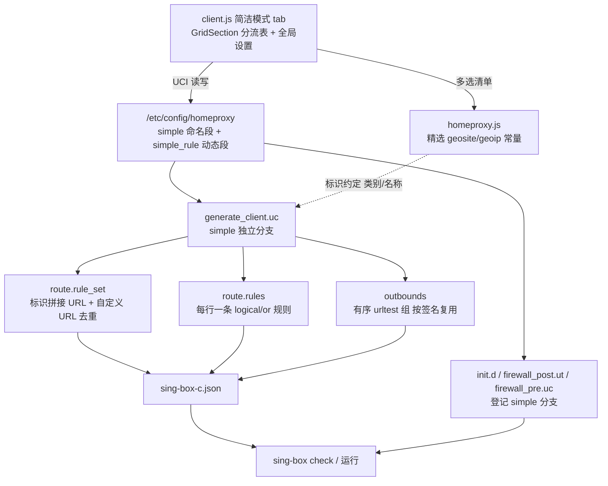

## User Requirements

在 HomeProxy 现有分流设置之外，新增一个「简洁模式」，让分流配置不再需要理解 routing_node / routing_rule / ruleset / dns 等多张复杂表格。用户希望：直接指定哪些规则集（来自 `MetaCubeX/meta-rules-dat` 的 `sing/geo`）走哪个节点；能自己补充域名、IP 类规则；多个规则集可指向同一个节点；每个节点还能指定多个 fallback 节点。

## Product Overview

新增「简洁模式」作为与 GFWList、绕过大陆、仅代理大陆、自定义路由、全局并列的独立路由模式。切换到该模式后，界面只保留一组精简配置：一张可增删、可排序的「分流规则表」，以及少量全局选项；原有复杂 tab 自动隐藏，已有的自定义路由配置完整保留、随时可切回。

## Core Features

- **一张分流规则表**：每行可同时选择多个内置规则集、填写任意规则集地址、填写自定义域名与 IP/CIDR，并统一指定一个目标节点；支持多行，天然支持「多规则集指向同一节点」。
- **规则集来源**：内置 MetaCubeX `sing/geo` 常用 geosite / geoip 规则集清单供多选，自动补全下载地址；同时允许手填任意规则集 URL。
- **按序故障转移**：每个目标节点可追加多个有序 fallback 节点，主节点不可用时才依次切换到后备节点，并可配置健康检查地址与探测间隔。
- **全局行为**：未命中任何分流规则的流量默认直连（可改为指定节点）；DNS 与规则集下载可走代理以避免污染与下载失败。
- **视觉与交互**：沿用现有 LuCI 管理界面风格，新增一个独立 tab 与一个可增删排序的表格，字段按「规则来源 / 目标节点 / 故障转移」分组；切换模式时无关配置项自动隐藏，界面保持精简。

## Tech Stack Selection

沿用项目既有技术栈，不引入任何新依赖、新服务或新构建链：

- **界面**：LuCI JavaScript `form.Map` / `view.extend` / `GridSection` / `taboption`，公共控件复用 `homeproxy.js` 中的 `CBIStaticList`、`loadDefaultLabel`、`validateUniqueValue`、`renderSectionAdd`。
- **配置**：UCI（`/etc/config/homeproxy`）命名段 + 动态集合段。
- **后端**：`ucode` 脚本 `generate_client.uc` 生成 sing-box JSON；procd init 脚本；`firewall4` nftables 模板 `firewall_post.ut` / `firewall_pre.uc`。
- **校验**：复用 `init.d/homeproxy` 已有的 `sing-box check` 关卡。
- **文案**：`_('...')` + `po/templates/homeproxy.pot` + `po/zh_Hans/homeproxy.po`。

关键取舍：**不启用 `experimental.clash_api`、不新增常驻守护进程、不新增 RPC/ACL 条目、不新增需打包的静态数据文件**。理由见下节，这也是本方案能做到低风险、小改动面的原因。

## Implementation Approach

### 策略

把「简洁模式」实现为 `config.routing_mode` 的一个新值 `simple`，数据用两类 UCI 段表达（全局设置 `simple` 命名段 + 分流表 `simple_rule` 动态段），后端在 `generate_client.uc` 中新增**独立分支**把分流表翻译为 sing-box 的 `route.rule_set`、`route.rules` 与 outbounds。现有 5 种模式的生成路径保持原样，仅在必须登记新模式的分支点做增量修改。

### 按序故障转移的落地方式（核心技术决策）

sing-box 原生没有 `fallback` / `loadbalance` 类型，全库也确认没有相关实现；但项目已稳定生成 `urltest`（`generate_client.uc:664-671`、`:727-737`）。方案采用 **`urltest` 原语 + 有序 `outbounds` 列表 + 极大 `tolerance`**：

- 把「主节点 + fallback1 + fallback2 …」按优先级顺序写入一个 urltest 的 `outbounds`；
- 设置极大的 `tolerance`，使「延迟差比较」退化为「保持列表中靠前的可用节点」，即延迟不再参与择优，行为变为**第一个通过健康检查的可用节点胜出**；
- 故障判定交给 sing-box 内置健康检查完成（`url` + `interval`），无需自写探测脚本；
- `interrupt_exist_connections: true` 使切换时中断旧连接，尽快落到新节点。

这满足用户所选「严格按序故障转移」的语义，且**区别于**用户未选的「urltest 自动择优」：后者按延迟选最快，本方案按列表顺序选第一个可用。

**未采用的替代方案及取舍**：`selector` + Clash API + 外部守护脚本轮询探测并切换，虽可做到更强的恢复语义，但会引入监听端口与 secret（安全面扩大）、常驻进程、ACL/RPC 变更、配置重载复杂度，与「简洁」目标及 YAGNI 相悖，且带来持续 I/O 与内存开销。**语义边界需如实告知**：主节点恢复后的切回依赖 urltest 周期性重测与大 tolerance 的保持逻辑，不保证立即回切；因此把健康检查地址、间隔暴露为可调项，并在界面文案注明，不宣称「瞬时回切」。

### 规则集来源与 URL 拼接（避免双份清单）

- 精选 geosite / geoip 清单作为**前端常量**加入 `homeproxy.js`（该库已有 `dns_strategy`、`tls_cipher_suites` 等静态清单，完全契合既有约定），供多选控件生成选项。
- UCI 只存**规则集标识**（形如 `geosite/geolocation-cn`、`geoip/cn`）与用户手填的完整 URL。
- 后端只实现「标识 → URL」的**拼接规则**：基址 + 类别 + 名称 + `.srs`，名称中的 `@` 编码为 `%40`；基址可配（jsDelivr 形式与项目现有 `fastly.jsdelivr.net` 风格一致、可达性更好，或 raw.githubusercontent）。
- 这样前端清单与后端无需同步两份大清单（DRY），自定义 URL 原样使用并复用 `client.js:1345-1361` 的 URL 校验范式。

### 一行分流规则的翻译（正确性关键点）

sing-box 一条普通 route rule 的不同字段之间是**逻辑与**，若把「多个规则集 + 域名 + IP」塞进一条 rule 会变成 AND 从而几乎不命中。方案采用项目已用过的 `type: 'logical'`、`mode: 'or'` 规则（`generate_client.uc:488-503` 有先例），**一行 → 一条 logical(or) 规则**，其下挂每个规则集、域名组、IP 组子条件，统一 `action: 'route'` 指向该行目标出站组。既保证 OR 语义，又让规则条目数保持为「行数」量级。

### 性能与可靠性

- 复杂度：生成的规则集条目数 = 全局唯一规则集数（按 tag 去重），urltest 组数 = 唯一「主节点 + fallback 序列」组合数（按签名缓存复用，通常远小于分流行数）。总生成量约为 O(分流行数 + 唯一规则集数 + 唯一节点数)，无组合爆炸。
- 用一次 `uci.foreach` + 节点配置 map 缓存，避免在循环中反复 `uci.get_all`；前端复用 `client.js:90-99` 已缓存的 `proxy_nodes`。
- 规则集由 sing-box 自身按 tag 去重下载并缓存，不产生重复下载；`download_detour` 指向可用代理出站，避免国内直连拉取失败（该出站不依赖规则集，不构成循环依赖）。
- 无新增常驻进程、无额外定时轮询、无启动期额外 I/O。

### 避免技术债

复用 `form.GridSection` 表格范式、`CBIStaticList` 有序多选、`hp.loadModalTitle` / `loadDefaultLabel` / `renderSectionAdd`、`generate_outbound()` / `get_outbound()`、`removeBlankAttrs()` 输出规范；新分支与现有分支并列而非改写，配置段命名遵循现有 `routing_*` / `dns_*` 风格。

## Implementation Notes

- **反向依赖必须逐处修正（最易漏的回归点）**：`client.js:128`、`:191` 的 `!reverse` 依赖、`:157` 的 `/^((?!custom).)+$/`、`:1479` / `:1511` 域名列表、以及 `node.js:399-420` 的 Apply 按钮，都是「非 custom 即显示」。新增 `simple` 后会让 `main_node`、`dns_server`、`main_udp_node`、Proxy/Direct 域名列表在新模式下误显示。改为**显式正向枚举**原有 4 种非 custom 模式，或把 `simple` 加入排除条件，不要继续依赖「排除 custom」这一隐含假设。
- **新模式分支登记清单（后端逐处核对，勿遗漏）**：
- `init.d/homeproxy:38-42`（outbound 判定，simple 不能取 `main_node` 的 `nil` 默认，否则服务不启动）、`:81-99`（dnsmasq case 需把 `simple` 归入全量 DNS 接管分支）、`:101`（`proxy_list.txt` 仅对旧模式生效）、`:233-236`（ruleset 目录准备）、tproxy/tun 相关判定。
- `firewall_post.ut:62-69`（`routing_mode !== 'custom'` 取 `main_node`，simple 需按 custom 类处理）、`:87`（tproxy 端口条件 `routing_mode === 'custom'` 需纳入 simple，否则 UDP 不生效）、`:325` / `:446`（LAN 全局代理规则）、以及 gfwlist / mainland_china 的 nft 分支——simple 刻意不匹配这些分支，让分流完全交给 sing-box route。
- `firewall_pre.uc:18-21`（tun 模式 outbound 判定需纳入 simple）。
- `generate_client.uc:62-99`、`:110-130`、`:436-505`、`:795-941`、`:945`（`experimental.cache_file`）。
- **配置默认值差异**：`/etc/config/homeproxy` 中 `routing.default_outbound` 为 `direct-out`，而 `generate_client.uc:96` / `init.d:41` 回退值为 `nil`。simple 段默认值需显式写入，避免依赖回退值导致服务不启动。
- **`migrate_config.uc` 必须登记新段类型**：`:18-28` 的 section 常量清单需加入 `simple` 与 `simple_rule`；确认迁移逻辑是否会清理未登记段，若无登记可能导致用户新增分流行在升级时被清除。
- **DNS 正确性**：simple 模式没有 `main_node`，需独立设置 `main-dns`（detour 指向可用代理出站）与 `route.default_domain_resolver`，否则节点域名解析与远端域名分流失效；沿用现有 `dns-in` + `hijack-dns` 与 sniff 规则，不改其他模式。
- **tag 命名**：simple 的规则集 tag 与出站组 tag 使用独立前缀（如 `simple-...`），与 custom 的 `cfg-<name>-rule` / `cfg-<name>-out` 命名空间隔离，避免两组配置互相覆盖。
- **日志与验证**：沿用现有 `log_level` 与 `>> "$LOG_PATH"`，不在生成脚本打印大配置；失败时只在 init 已有错误点追加一条可操作信息。验证依赖已有 `sing-box check`，并补边界用例：空分流表、仅有自定义 URL、单行指向多规则集、多行共用同一节点、fallback 列表为空/重复节点、节点被删除后的悬空引用。
- **Blast radius 控制**：`routing_mode` 默认值保持 `bypass_mainland_china` 不变；不改动 `custom` / `routing_node` / `ruleset` / `routing_rule` / `dns_server` 的任何既有数据与生成语义；不新增依赖、RPC、ACL 与打包文件（若最终决定新增静态清单文件，则同步 `Makefile` 的 conffiles 与 `.github/build-ipk.sh` 复制规则）。

## Architecture Design

### 系统结构与数据流



### 组件职责

- **表示层**（`client.js`、`node.js`、`homeproxy.js`）：仅负责新增 tab、分流表 CRUD、字段校验与模式显隐；不承载业务规则。
- **数据层**（UCI `simple` / `simple_rule`）：解耦界面与生成器；全局参数与逐行规则分离，避免每行重复健康检查配置。
- **翻译层**（`generate_client.uc` simple 分支）：唯一负责把分流表翻译为 sing-box 配置；规则集 URL 拼接、tag 去重、urltest 组构造均内聚于此。
- **运行层**（init + firewall 模板）：只做「模式登记」，不参与分流决策。

### 兼容性

新增模式与原有 5 种模式互斥共存；切换模式只改变生效分支，不清理任何既有 UCI 段。

## Directory Structure

本次为在既有项目内增量扩展，**全部为修改，无新增文件**（精选清单作为 JS 常量、URL 由后端按规则拼接，因此无需新增需打包的数据文件）。

```
homeproxy/
├── htdocs/luci-static/resources/
│   ├── homeproxy.js                          # [MODIFY] 公共库。新增精选规则集清单常量（geosite/geoip 常用项，含显示名），风格对齐已有 dns_strategy / tls_cipher_suites；供简洁模式多选控件生成选项，并作为「类别/名称」标识约定的唯一出处。
│   └── view/homeproxy/
│       ├── client.js                         # [MODIFY] 主界面。routing_mode 下拉新增 simple 值；新增「简洁分流」tab 承载全局设置（默认出站、DNS、健康检查地址/间隔、规则集下载源/出站）与 simple_rule 的 GridSection（可增删、排序、行内启停）；分流行字段：内置规则集多选、自定义规则集 URL 列表、域名列表、IP/CIDR 列表、主节点下拉、有序 fallback 多选框；全部 depends 到 simple；修正 :128/:157/:191/:1479/:1511 的反向依赖为显式枚举；onchange 保存逻辑兼容新模式。
│       └── node.js                           # [MODIFY] 节点页。修正 :399-420 的 Apply 按钮显隐，使其仅在原有非 custom 的 4 种模式下出现，避免简洁模式下把节点误写为 main_node。
├── root/etc/
│   ├── config/homeproxy                      # [MODIFY] UCI 默认配置。新增 config homeproxy 'simple' 命名段，写入 default_outbound、dns_server、health_check_url、health_check_interval、ruleset 下载源与 download_detour 等默认值；routing_mode 默认值保持不变。
│   ├── init.d/homeproxy                      # [MODIFY] 启动脚本。outbound_node 判定纳入 simple（不得回退 nil 导致不启动）；dnsmasq case 把 simple 归入全量 DNS 接管分支；ruleset 目录、tproxy/tun 判定逐处登记；沿用已有 sing-box check 关卡。
│   └── homeproxy/scripts/
│       ├── generate_client.uc                # [MODIFY] 核心生成器。新增 simple 独立分支：变量初始化读取 simple 段；按签名缓存生成「主节点 + 有序 fallback」的 urltest 组（极大 tolerance、interrupt_exist_connections、健康检查 url/interval）；把规则集标识拼接为 URL、与自定义 URL 一并去重生成 remote rule_set；每行生成一条 logical/or 路由规则指向对应组；设置 route.final、main-dns 与 default_domain_resolver；experimental.cache_file 纳入 simple。
│       ├── migrate_config.uc                 # [MODIFY] 配置迁移。section 常量清单加入 simple 与 simple_rule，补默认值并确认清理逻辑不会误删用户分流行。
│       ├── firewall_post.ut                  # [MODIFY] nft 模板。把 :62-69、:87、:325、:446 等处「custom 类」判定扩展到 simple；确认 simple 刻意不落入 gfwlist / mainland_china 的 nft 直连分支，分流交给 sing-box；保证 tproxy 端口与基础 redirect 规则正常生成。
│       └── firewall_pre.uc                   # [MODIFY] tun 前置脚本。:18-21 的 outbound 判定纳入 simple，保证 tun 模式下 tun_name 正确设置。
├── po/
│   ├── templates/homeproxy.pot               # [MODIFY] 新增全部 msgid（简洁模式、分流表、规则集清单、fallback、健康检查等），带源码位置注释。
│   └── zh_Hans/homeproxy.po                  # [MODIFY] 补齐简中译文，沿用「路由设置 / 规则集 / 自定义路由」既有译法风格。
├── Makefile                                  # [MODIFY/按需] 仅当最终新增静态清单文件时，才需把该文件纳入 conffiles 或安装规则；采用 JS 常量方案则无需改动。
└── .github/build-ipk.sh                      # [MODIFY/按需] 同上，仅在新增静态文件时补充复制规则；当前方案下 root/* 与 htdocs/* 的既有复制已覆盖全部改动。
```

## Key Code Structures

以下为跨模块依赖的 UCI 数据契约（仅结构与字段语义，非实现体）。

**1. 分流表动态段 `simple_rule`（每行一条分流规则）**

```
config simple_rule 'cfgXXXX'
    option label          '流媒体'              # 显示名，复用 validateUniqueValue 校验唯一
    option enabled        '1'
    list   rule_sets      'geosite/netflix'    # 内置规则集标识：类别/名称，可多选
    list   rule_sets      'geosite/youtube'    # 多个规则集 → 同一节点
    list   rule_set_urls  'https://.../x.srs' # 手填任意规则集 URL，可多条
    list   domains        'example.com'       # 自定义域名（domain + domain_suffix 语义）
    list   ip_cidrs       '1.2.3.0/24'        # 自定义 IP/CIDR
    option node           'cfgYYYY'           # 主节点，引用 node 段名
    list   fallback_nodes 'cfgZZZZ'           # 有序 fallback 节点列表，顺序即优先级
```

**2. 全局设置命名段 `simple`**

```
config homeproxy 'simple'
    option default_outbound        'direct-out'   # 未命中流量
    option dns_server              '8.8.8.8'     # 远端 DNS
    option health_check_url        'http://www.gstatic.com/generate_204'
    option health_check_interval   '180'
    option ruleset_url_base        '<jsDelivr 或 raw 基址>'   # 标识拼接下载基址
    option ruleset_download_detour '<可用出站组 tag 或 direct-out>'
```

**3. 故障转移出站组生成契约**（`generate_client.uc` 输出对象关键字段）

```
{
    type: 'urltest',
    tag: 'simple-grp-<签名>',                 // 由 主节点 + 有序 fallback 序列 计算，签名相同则复用
    outbounds: [ 'cfg-主节点-out', 'cfg-fb1-out', ... ],  // 严格按优先级顺序
    url: health_check_url,
    interval: strToTime(health_check_interval),
    tolerance: <极大值>,                       // 使延迟不参与择优，退化为「第一个可用」
    interrupt_exist_connections: true
}
```